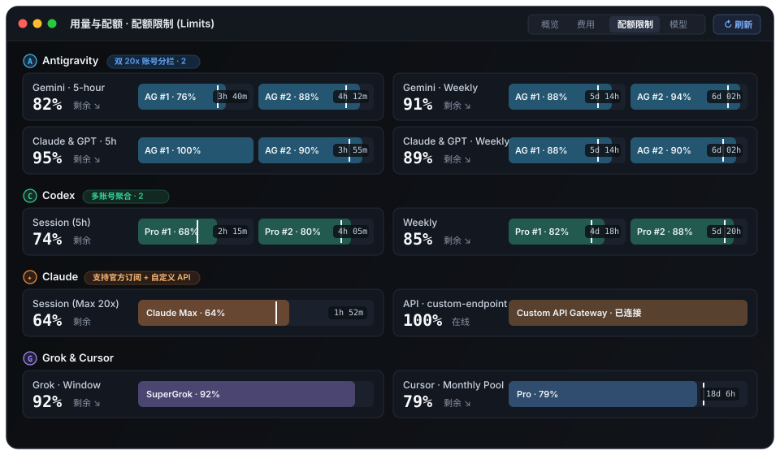
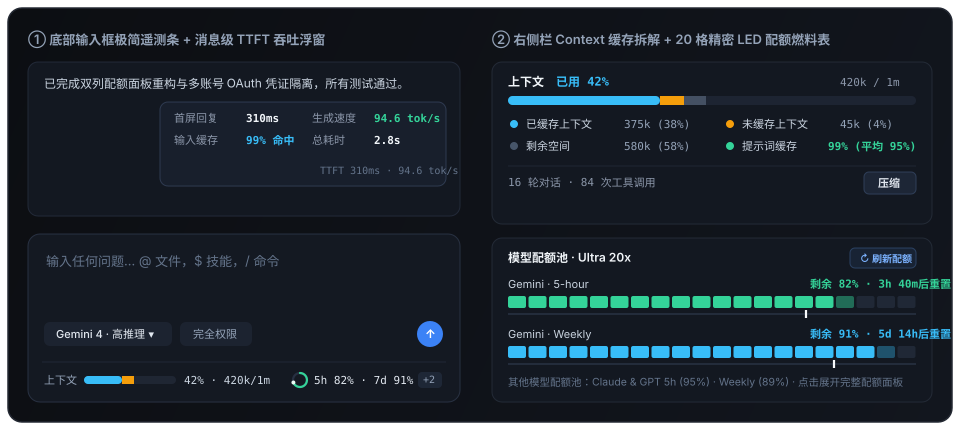

<div align="center">


# T3 Code Quota UI · 界面与多账号配额增强版

**一行命令，为 macOS 版 [T3 Code](https://github.com/pingdotgg/t3code) 注入「双列紧凑配额大盘 + 多厂商/多账号实时分栏监控 + 上下文缓存拆解 + 原生中文界面」**

*One-command macOS UI & multi-account quota enhancement pack for T3 Code — featuring a single-screen 2-column Limits dashboard, side-by-side multi-account quota bars, context breakdown telemetry, and optional `zh-CN` localization.*

[](LICENSE)
[-38bdf8.svg)](#一键安装--quick-install)
[](https://github.com/pingdotgg/t3code)
[-f59e0b.svg)](#一键安装--quick-install)

[**中文文档**](#核心亮点) · [**一键安装**](#一键安装--quick-install) · [**English Guide**](#english-documentation) · [**致谢与协议**](#上游项目致谢与开源协议--credits--license)

</div>

---

## 界面预览 / Visual Preview

### 1. 双列紧凑 `Limits` 全景配额面板（多厂商 · 双账号分栏一屏看全）

<p align="center">
  
</p>

### 2. 右侧栏 Context 缓存拆解 + 20 格 LED 燃料矩阵 + 底部腕表遥测条

<p align="center">
  
</p>

---

## 核心亮点

日常重度使用 **Claude Code / Codex / Antigravity (Gemini & Claude 20x) / Cursor / Grok** 多订阅与多账号开发的同学，在原版界面中经常遇到「单列卡片太长需要反复滚动」「同厂商双账号被合并折叠看不到各自余量」「自定义 API 端点被直接隐藏」等痛点。本项目在不破坏任何本地会话数据的前提下提供无损增强：

| 功能模块 | 官方默认表现 | 本增强版表现 (`t3code-quota-ui`) |
| :--- | :--- | :--- |
| **`Limits` 面板布局** | 单列大卡片堆叠，3 个以上厂商需上下翻页 | **双列紧凑网格（`2-Column Grid`）**，纵向高度压缩约 **65%**，桌面端一屏总览全部厂商 |
| **同厂商多账号展示** | 同环境多个实例（如双 Google 20x 号）易折叠合并 | **单条内左右并排分栏（`· 2` / `· N`）**，实时对比每个账号剩余百分比、重置倒计时与时间游标针 |
| **Antigravity 新版凭证发现与隔离** | `1.5.14+` 迁移钥匙串后部分分支探测不到配额；多号登录易互相覆盖 | **全动态发现本地凭证 + 实例级文件存储隔离**，双 20x 账号各自独立刷新互不串号 |
| **Claude 自定义 API 端点** | 接入第三方网关或自定义 `BASE_URL` 时整栏隐藏 | 在 `Limits` 页清晰展示 **`API · <网关域名>`** 在线状态卡片，与官方订阅同屏管理 |
| **上下文与性能遥测** (`--build-full` / Telemetry 版) | 仅基础上下文展示 | **底部 `Ctx` 多色分段胶囊 + 腕表圆弧表盘 + 消息级 `TTFT / tok/s` 浮窗 + 右侧 20 格 LED 燃料矩阵** |
| **中英双语界面** | 仅部分设置项支持中文 | 默认开启**全局无损中文汉化**（严格跳过代码块、终端与输入框），支持 `--lang en` 保持英文 |
| **安装与回滚安全性** | 需手动拉源码配置 Node/Rust 编译环境 | **3 秒极速注入**（自动复用 App 内置运行时，**零外部依赖**），修改前自动快照备份，**1 秒无损还原** |

---

## 一键安装 / Quick Install

> **提示**：脚本仅在你的 Mac 本地运行，自动定位 `/Applications` 下的 `T3 Code.app`、`T3 Code (Beta).app` 或 `t3 (Beta).app`，即使电脑没装 Node.js 也能直接复用 T3 内置运行时完成补丁。

### 方式一：3 秒极速补丁（推荐绝大多数用户，零依赖）

打开 macOS **终端（Terminal）**，粘贴以下一行命令回车：

```bash
curl -fsSL https://raw.githubusercontent.com/Leobai03/t3code-quota-ui/main/install.sh | bash
```

安装完成后，按 **`Cmd + Q`** 完全退出 T3 Code 再重新打开即可生效！（也可以加上 `--relaunch` 让脚本自动重启应用）：

```bash
# 安装并自动重启 T3 Code
curl -fsSL https://raw.githubusercontent.com/Leobai03/t3code-quota-ui/main/install.sh | bash -s -- --relaunch

# 如果你偏好保留全英文界面，仅启用「双列紧凑 Limits + 多账号分栏 + 自定义 API 显示」：
curl -fsSL https://raw.githubusercontent.com/Leobai03/t3code-quota-ui/main/install.sh | bash -s -- --lang en
```

### 方式二：从源码编译完整遥测独立版（`--build-full`）

如果你目前只装了官方原版，还想完整体验**「底部腕表圆弧遥测条 + 消息右下角 TTFT 吞吐浮窗 + 右侧栏 20 格 LED 燃料矩阵」**，且本机已安装 `git`、`node`、`pnpm`，可一键拉取上游遥测分支并打入本仓库全部增强补丁，在本地编译出独立的 `/Applications/t3 (Beta).app`（与原版共享 `~/.t3` 全部聊天记录）：

```bash
curl -fsSL https://raw.githubusercontent.com/Leobai03/t3code-quota-ui/main/install.sh | bash -s -- --build-full
```

---

## 一键卸载与无损回滚 / One-Command Rollback

安装脚本在首次修改前，会将原始 `app.asar` 与 `Info.plist` 完整备份至 `~/.t3/quota-ui-backups/`。随时执行以下命令即可 **1 秒字节级还原**回官方原版状态：

```bash
curl -fsSL https://raw.githubusercontent.com/Leobai03/t3code-quota-ui/main/uninstall.sh | bash
```

---

## 多账号并排配置指南（以双 Google Antigravity / 双 Codex 为例）

1. 打开 T3 Code 左下角 **设置（Settings）→ 模型提供方（Providers）**。
2. 点击添加第二个同类型提供方实例（例如新增第二个 `Antigravity` 或 `Codex` 实例，自定义显示名称如 `AG #2`）。
3. 分别完成登录授权后，打开左侧或右上角 **用量与配额（Usage）→ 配额限制（Limits）**：
   - 两个实例会自动在同一配额窗口内以**左右双段分栏**独立渲染剩余百分比与重置时间；
   - 已生成独立凭证文件的实例会自动启用进程级文件隔离，重新登录第二个账号时不会覆盖第一个账号的本地会话。

---

## 仓库目录结构 / Repository Structure

```text
t3code-quota-ui/
├── install.sh                       # macOS 一键安装脚本（支持零依赖 3 秒补丁 & --build-full 源码构建）
├── uninstall.sh                     # macOS 一键无损还原脚本（基于 ~/.t3/quota-ui-backups 快照回滚）
├── scripts/
│   ├── patch-asar.mjs               # 纯 Node 标准库实现的跨版本 ASAR 补丁器（自动重算 SHA-256 完整性哈希）
│   └── apply-source-patches.mjs     # 面向源码编译用户的 TypeScript 源码补丁脚本
├── assets/                          # 矢量界面预览图与图标资源
└── LICENSE                          # MIT 开源协议与上游版权声明
```

---

## English Documentation

### What is `t3code-quota-ui`?

`t3code-quota-ui` is an open-source, non-destructive macOS UI & multi-account quota enhancement toolkit for [**T3 Code**](https://github.com/pingdotgg/t3code):

1. **Compact 2-Column `Limits` Grid**: Shrinks vertical height by ~65% (`md:grid-cols-2`, compact card geometry, tabular typography) so every connected provider (`Antigravity`, `Codex`, `Claude`, `Cursor`, `Grok`) fits on a single desktop screen without scrolling.
2. **Multi-Account Side-by-Side Split Bars**: Prevents multiple enabled provider instances on the same machine (e.g., two 20x Ultra accounts) from collapsing into a single bar, displaying independent per-account segments, pace ticks, and reset timers.
3. **Dynamic Credential Sync & Isolation + Custom Claude API Visibility**: Dynamically discovers local OAuth credentials with per-profile file isolation (zero hardcoded keys or paths) and displays custom Claude API endpoints cleanly in `Usage -> Limits`.
4. **Zero-Dependency 3-Second Patch & Instant Rollback**: Automatically falls back to T3 Code's embedded Electron-as-Node runtime if Node.js isn't installed globally, backs up your original bundle to `~/.t3/quota-ui-backups/`, and re-signs the `.app` bundle cleanly.

### Quick Start (macOS)

```bash
# Install with English UI labels preserved:
curl -fsSL https://raw.githubusercontent.com/Leobai03/t3code-quota-ui/main/install.sh | bash -s -- --lang en

# Install with Chinese (zh-CN) UI localization (default):
curl -fsSL https://raw.githubusercontent.com/Leobai03/t3code-quota-ui/main/install.sh | bash

# Restore original unpatched T3 Code anytime:
curl -fsSL https://raw.githubusercontent.com/Leobai03/t3code-quota-ui/main/uninstall.sh | bash
```

---

## 常见问题 / FAQ

<details>
<summary><b>Q1：安装补丁后聊天记录、项目配置或账号信息会丢失吗？</b></summary>

**完全不会。** T3 Code 的所有会话数据库、工作树与账号配置均存放在 `~/.t3/userdata` 中，本补丁仅调整 `/Applications` 下应用包内的前端布局与配额聚合渲染逻辑，不触碰任何用户业务数据。
</details>

<details>
<summary><b>Q2：T3 Code 官方版本自动更新后需要重新执行吗？</b></summary>

是的。当官方客户端更新替换了 `app.asar` 后，只需重新运行一次一行安装命令（3 秒完成），脚本会自动检测新版本号、刷新备份快照并重新应用增强界面。
</details>

<details>
<summary><b>Q3：打开应用时如果提示 macOS Gatekeeper 签名校验提示怎么办？</b></summary>

`install.sh` 已自动执行 `xattr -cr`、更新 `Info.plist` 中的 `ElectronAsarIntegrity` SHA-256 摘要并完成本地 `codesign --force --deep --sign -` 重签名。若个别系统安全策略拦截，可在终端运行：
```bash
xattr -cr "/Applications/T3 Code.app" "/Applications/T3 Code (Beta).app" "/Applications/t3 (Beta).app" 2>/dev/null || true
```
</details>

<details>
<summary><b>Q4：补丁脚本会上传我的 Token 或配额数据吗？</b></summary>

**绝不上传。** 仓库内全部代码均为纯明文 Shell 与 Node 标准库脚本（零第三方 npm 依赖、零混淆二进制、零外部网络上报），所有配额读取均在本地客户端与你已授权的模型官方接口之间直接完成，欢迎随时审阅 [`scripts/patch-asar.mjs`](scripts/patch-asar.mjs)。
</details>

---

## 上游项目致谢与开源协议 / Credits & License

本项目基于 **MIT License** 开源发布，谨向以下优秀的上游开源项目与作者致谢：

- **[pingdotgg/t3code](https://github.com/pingdotgg/t3code)** — 由 Theo Browne 与 Ping Labs（T3 Tools Inc.）打造的官方开源客户端与多代理编排底座（[MIT License](https://github.com/pingdotgg/t3code/blob/main/LICENSE)）。
- **[nanami-0713/t3code](https://github.com/nanami-0713/t3code)** (`feat/restrained-telemetry-ui`) — 提供了极具美感的克制派底部遥测状态条、Context 分段卡片与 20 格配额燃料矩阵设计灵感与开源分支（MIT License）。

---

## 免责声明 / Disclaimer

本项目为社区爱好者维护的开源界面增强补丁，与 T3 Tools Inc.、Anthropic、OpenAI、Google、xAI 或 Cursor 官方无隶属关系。请在遵守各模型服务商条款及上游开源协议的前提下自行使用；修改本地应用包前脚本会自动创建备份，如有任何异常可随时通过 `uninstall.sh` 一键还原。
