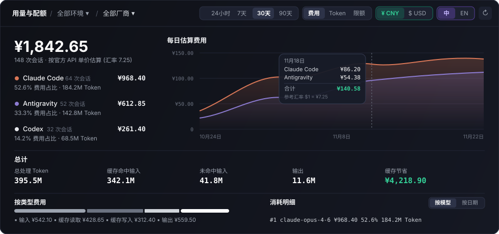

<div align="center">


# T3 Code Quota UI · 界面与多账号配额增强版 `v1.1.0`

**一行命令，为 macOS 版 [T3 Code](https://github.com/pingdotgg/t3code) 注入「双列紧凑配额大盘 + 多账号实时分栏 + `¥ 人民币 / $ 美元` 一键换算 + `中 / EN` 实时免重启双语切换」**

*One-command macOS UI & multi-account quota enhancement pack for T3 Code — featuring a single-screen 2-column Limits dashboard, side-by-side multi-account quota bars, instant `¥ CNY / $ USD` currency conversion, and live `中 / EN` bilingual switching.*

[](https://github.com/Leobai03/t3code-quota-ui/releases/tag/v1.1.0)
[](LICENSE)
[-38bdf8.svg)](#一键安装--quick-install)
[](https://github.com/pingdotgg/t3code)
[-f59e0b.svg)](#一键安装--quick-install)

[**v1.1.0 新特性**](#v110-重磅升级) · [**核心亮点**](#核心亮点) · [**一键安装**](#一键安装--quick-install) · [**English Guide**](#english-documentation) · [**致谢与协议**](#上游项目致谢与开源协议--credits--license)

</div>

---

## `v1.1.0` 重磅升级

1. **「`¥ CNY` / `$ USD`」一键货币实时切换（`localStorage` 持久化）**：
   - 在「用量与配额」顶部工具栏新增原生分段按钮 **`[¥ CNY | $ USD]`**；
   - 切至人民币后，全页所有金额（**顶部大字总费用、各厂商右侧费用与副标题费用、折线图圆整人民币 Y 轴刻度、Hover Tooltip 浮窗金额与合计、`缓存节省`、`按类型费用`、`按速度费用`、`溢价`、底部 `消耗明细` 表格费用列与模型弹窗**）全部按汇率（默认 `7.25`，Tooltip 自动标注参考汇率，亦可通过 `localStorage["t3code:quota-ui-fx-rate"]` 自定义）毫秒级实时换算为 **`¥` 人民币**；切回 **`$ USD`** 瞬间还原美元。
2. **「`中` / `EN`」实时免重启双语切换 + `费用 / Token / 限额` 三页签全量深度汉化**：
   - 顶部工具栏新增 **`[中 | EN]`** 一键切换按钮（默认中文，持久化保存至 `localStorage`，**点击立即生效、无需重启客户端**）；
   - 彻底补齐 `费用 (Cost)`、`Token (Tokens)`、`限额 (Limits)` 全部文案汉化：`全部环境 / 全部厂商`、`24小时 / 7天 / 30天 / 90天`、`次会话`、`按官方 API 单价估算`、`费用占比 / Token 占比`、`每日估算费用 / 每日处理 Token`、`总计 / 总处理 Token / 缓存命中输入 / 未命中输入 / 输出 / 缓存节省`、`按类型费用 / 按速度费用 / 按类型 Token`、`输入 / 缓存读取 / 缓存写入 / 其他 / 标准 / 极速 / 溢价`、`消耗明细 / 按模型 / 按日期 / 占比 / 合计` 以及 `限额` 页全部配额窗口与重置状态提示。

---

## 界面预览 / Visual Preview

### 1. `v1.1.0` 新增：`¥ CNY / $ USD` 实时汇率换算 + `中 / EN` 一键双语全汉化大盘

<p align="center">
  
</p>

### 2. 双列紧凑 `限额 (Limits)` 全景配额面板（多厂商 · 双账号分栏一屏看全）

<p align="center">
  
</p>

### 3. 右侧栏 Context 缓存拆解 + 20 格 LED 燃料矩阵 + 底部腕表遥测条

<p align="center">
  
</p>

---

## 核心亮点

日常重度使用 **Claude Code / Codex / Antigravity (Gemini & Claude 20x) / Cursor / Grok** 多订阅与多账号开发的同学，在原版界面中经常遇到「单列卡片太长需要反复滚动」「同厂商双账号被合并折叠看不到各自余量」「美元账单换算不直观」「中英文混杂」等痛点。本项目在不破坏任何本地会话数据的前提下提供无损增强：

| 功能模块 | 官方默认表现 | 本增强版表现 (`t3code-quota-ui v1.1.0`) |
| :--- | :--- | :--- |
| **计价货币切换** | 仅固定显示 `$ USD` 美元 | **顶部 `[¥ CNY \| $ USD]` 一键切换**，全页卡片、折线图 Y 轴刻度、Tooltip 与明细表实时换算人民币（支持自定义汇率） |
| **中英双语实时切换** | 英文界面或需改参数重装 | **顶部 `[中 \| EN]` 免重启秒切**，`费用 / Token / 限额` 三大页签 100% 完整汉化，持久化记忆偏好 |
| **`Limits` 面板布局** | 单列大卡片堆叠，3 个以上厂商需上下翻页 | **双列紧凑网格（`2-Column Grid`）**，纵向高度压缩约 **65%**，桌面端一屏总览全部厂商 |
| **同厂商多账号展示** | 同环境多个实例（如双 Google 20x 号）易折叠合并 | **单条内左右并排分栏（`· 2` / `· N`）**，实时对比每个账号剩余百分比、重置倒计时与时间游标针 |
| **Antigravity 新版凭证发现与隔离** | `1.5.14+` 迁移钥匙串后部分分支探测不到配额；多号登录易互相覆盖 | **全动态发现本地凭证 + 实例级文件存储隔离**，双 20x 账号各自独立刷新互不串号 |
| **Claude 自定义 API 端点** | 接入第三方网关或自定义 `BASE_URL` 时整栏隐藏 | 在 `限额` 页清晰展示 **`API · <网关域名>`** 在线状态卡片，与官方订阅同屏管理 |
| **安装与回滚安全性** | 需手动拉源码配置 Node/Rust 编译环境 | **3 秒极速注入**（自动复用 App 内置运行时，**零外部依赖**），修改前自动快照备份，**1 秒无损还原** |

---

## 一键安装 / Quick Install

> **提示**：脚本仅在你的 Mac 本地运行，自动定位 `/Applications` 下的 `T3 Code.app`、`T3 Code (Beta).app` 或 `t3 (Beta).app`，即使电脑没装 Node.js 也能直接复用 T3 内置运行时完成补丁。已安装 `v1.0.0` 的用户直接重跑同一行命令即可无损升级至 `v1.1.0`！

### 方式一：3 秒极速补丁（推荐绝大多数用户，零依赖）

打开 macOS **终端（Terminal）**，粘贴以下一行命令回车：

```bash
curl -fsSL https://raw.githubusercontent.com/Leobai03/t3code-quota-ui/main/install.sh | bash
```

安装完成后，按 **`Cmd + Q`** 完全退出 T3 Code 再重新打开即可生效！（进入「用量与配额」后即可随时在顶部免重启切换 `¥ CNY / $ USD` 与 `中 / EN`）：

```bash
# 安装并自动重启 T3 Code
curl -fsSL https://raw.githubusercontent.com/Leobai03/t3code-quota-ui/main/install.sh | bash -s -- --relaunch

# 若希望首次启动默认使用英文界面（进入页面后仍可随时点 [中 | EN] 切换）：
curl -fsSL https://raw.githubusercontent.com/Leobai03/t3code-quota-ui/main/install.sh | bash -s -- --lang en
```

### 方式二：从源码编译完整遥测独立版（`--build-full`）

如果你目前只装了官方原版，还想完整体验**「底部腕表圆弧遥测条 + 消息右下角 TTFT 吞吐浮窗 + 右侧栏 20 格 LED 燃料矩阵」**，且本机已安装 `git`、`node`、`pnpm`，可一键拉取上游遥测分支并打入本仓库全部增强补丁，在本地编译出独立的 `/Applications/t3 (Beta).app`（与原版共享 `~/.t3` 全部聊天记录）：

```bash
curl -fsSL https://raw.githubusercontent.com/Leobai03/t3code-quota-ui/main/install.sh | bash -s -- --build-full
```

---

## 一键卸载与无损回滚 / One-Command Rollback

安装脚本在首次修改前，会将原始 `app.asar` 与 `Info.plist` 完整备份至 `~/.t3/quota-ui-backups/`。随时执行以下命令即可 **1 秒字节级还原**回修改前状态：

```bash
curl -fsSL https://raw.githubusercontent.com/Leobai03/t3code-quota-ui/main/uninstall.sh | bash
```

---

## 多账号并排配置指南（以双 Google Antigravity / 双 Codex 为例）

1. 打开 T3 Code 左下角 **设置（Settings）→ 模型提供方（Providers）**。
2. 点击添加第二个同类型提供方实例（例如新增第二个 `Antigravity` 或 `Codex` 实例，自定义显示名称如 `AG #2`）。
3. 分别完成登录授权后，打开左侧或右上角 **用量与配额（Usage）→ 限额（Limits）**：
   - 两个实例会自动在同一配额窗口内以**左右双段分栏**独立渲染剩余百分比与重置时间；
   - 已生成独立凭证文件的实例会自动启用进程级文件隔离，重新登录第二个账号时不会覆盖第一个账号的本地会话。

---

## 仓库目录结构 / Repository Structure

```text
t3code-quota-ui/
├── install.sh                       # macOS 一键安装脚本（支持零依赖 3 秒补丁 & --build-full 源码构建）
├── uninstall.sh                     # macOS 一键无损还原脚本（基于 ~/.t3/quota-ui-backups 快照回滚）
├── scripts/
│   ├── patch-asar.mjs               # 纯 Node 标准库实现的跨版本 ASAR 补丁器（含 ¥/$ 汇率切换与中英双语引擎）
│   └── apply-source-patches.mjs     # 面向源码编译用户的自包含 TypeScript 源码补丁脚本
├── assets/                          # 矢量界面预览图与图标资源
└── LICENSE                          # MIT 开源协议与上游版权声明
```

---

## English Documentation

### What's New in `v1.1.0`?

- **Instant `¥ CNY / $ USD` Currency Switcher**: Added a native segmented toggle in the `Usage` header toolbar (`localStorage` persisted). Converts every dollar figure across `Cost` and `Tokens` — headline totals, per-provider totals & subtitles, chart Y-axis ticks (with clean rounded RMB intervals), chart hover tooltips (with reference FX rate note), `Cache savings`, `Cost by type`, `Cost by speed`, `Premium`, and `Breakdown` tables — in real time (`1 USD = 7.25 CNY` default, customizable via `localStorage.setItem("t3code:quota-ui-fx-rate", "7.30")`).
- **Live `中 / EN` Language Switcher (No Restart Required)**: Switch between full Chinese (`zh-CN`) and original English (`EN`) instantaneously from the `Usage` toolbar, with 100% localization coverage across `Cost`, `Tokens`, and `Limits`.

### Core Features

1. **Compact 2-Column `Limits` Grid**: Shrinks vertical height by ~65% (`md:grid-cols-2`, compact card geometry, tabular typography) so every connected provider (`Antigravity`, `Codex`, `Claude`, `Cursor`, `Grok`) fits on a single desktop screen without scrolling.
2. **Multi-Account Side-by-Side Split Bars**: Prevents multiple enabled provider instances on the same machine (e.g., two 20x Ultra accounts) from collapsing into a single bar, displaying independent per-account segments, pace ticks, and reset timers.
3. **Dynamic Credential Sync & Isolation + Custom Claude API Visibility**: Dynamically discovers local OAuth credentials with per-profile file isolation (zero hardcoded keys or paths) and displays custom Claude API endpoints cleanly in `Usage -> Limits`.
4. **Zero-Dependency 3-Second Patch & Instant Rollback**: Automatically falls back to T3 Code's embedded Electron-as-Node runtime if Node.js isn't installed globally, backs up your original bundle to `~/.t3/quota-ui-backups/`, and re-signs the `.app` bundle cleanly.

### Quick Start (macOS)

```bash
# Install with Chinese (zh-CN) default UI (can toggle to EN anytime in toolbar):
curl -fsSL https://raw.githubusercontent.com/Leobai03/t3code-quota-ui/main/install.sh | bash

# Install with English (EN) default UI (can toggle to 中 anytime in toolbar):
curl -fsSL https://raw.githubusercontent.com/Leobai03/t3code-quota-ui/main/install.sh | bash -s -- --lang en

# Restore original unpatched T3 Code anytime:
curl -fsSL https://raw.githubusercontent.com/Leobai03/t3code-quota-ui/main/uninstall.sh | bash
```

---

## 常见问题 / FAQ

<details>
<summary><b>Q1：如何自定义人民币参考汇率（默认 7.25）？</b></summary>

默认使用参考汇率 `1 USD = 7.25 CNY`（在货币按钮与折线图悬浮窗中均有标注）。如需自定义汇率，可在开发者工具控制台执行 `localStorage.setItem("t3code:quota-ui-fx-rate", "7.20")` 后点击一次货币按钮即可立即按新汇率重算。
</details>

<details>
<summary><b>Q2：安装补丁后聊天记录、项目配置或账号信息会丢失吗？</b></summary>

**完全不会。** T3 Code 的所有会话数据库、工作树与账号配置均存放在 `~/.t3/userdata` 中，本补丁仅调整 `/Applications` 下应用包内的前端布局与配额聚合渲染逻辑，不触碰任何用户业务数据。
</details>

<details>
<summary><b>Q3：T3 Code 官方版本自动更新后需要重新执行吗？</b></summary>

是的。当官方客户端更新替换了 `app.asar` 后，只需重新运行一次一行安装命令（3 秒完成），脚本会自动检测新版本号、刷新备份快照并重新应用增强界面。
</details>

<details>
<summary><b>Q4：补丁脚本会上传我的 Token 或配额数据吗？</b></summary>

**绝不上传。** 仓库内全部代码均为纯明文 Shell 与 Node 标准库脚本（零第三方 npm 依赖、零混淆二进制、零外部网络上报），所有配额读取均在本地客户端与你已授权的模型官方接口之间直接完成，欢迎随时审阅 [`scripts/patch-asar.mjs`](scripts/patch-asar.mjs)。
</details>

---

## 上游项目致谢与开源协议 / Credits & License

本项目基于 **MIT License** 开源发布，谨向以下优秀的上游开源项目与作者致谢：

- **[pingdotgg/t3code](https://github.com/pingdotgg/t3code)** — 由 Theo Browne 与 Ping Labs（T3 Tools Inc.）打造的官方开源客户端与多代理编排底座（[MIT License](https://github.com/pingdotgg/t3code/blob/main/LICENSE)）。
- **[nanami-0713/t3code](https://github.com/nanami-0713/t3code)** (`feat/restrained-telemetry-ui`) — 提供了极具美感的克制派底部遥测状态条、Context 分段卡片与 20 格配额燃料矩阵设计灵感与开源分支（MIT License）。

---

## 免责声明 / Disclaimer

本项目为社区爱好者维护的开源界面增强补丁，与 T3 Tools Inc.、Anthropic、OpenAI、Google、xAI 或 Cursor 官方无隶属关系。请在遵守各模型服务商条款及上游开源协议的前提下自行使用；修改本地应用包前脚本会自动创建备份，如有任何异常可随时通过 `uninstall.sh` 一键还原。
